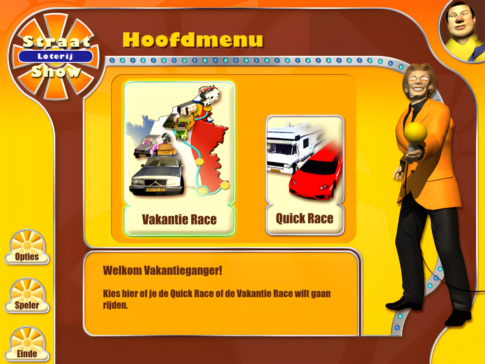
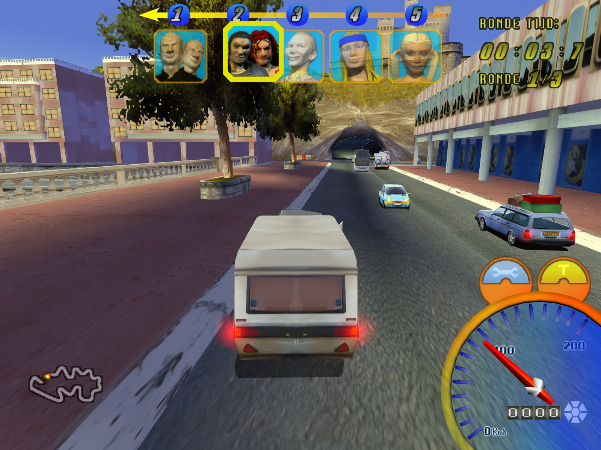
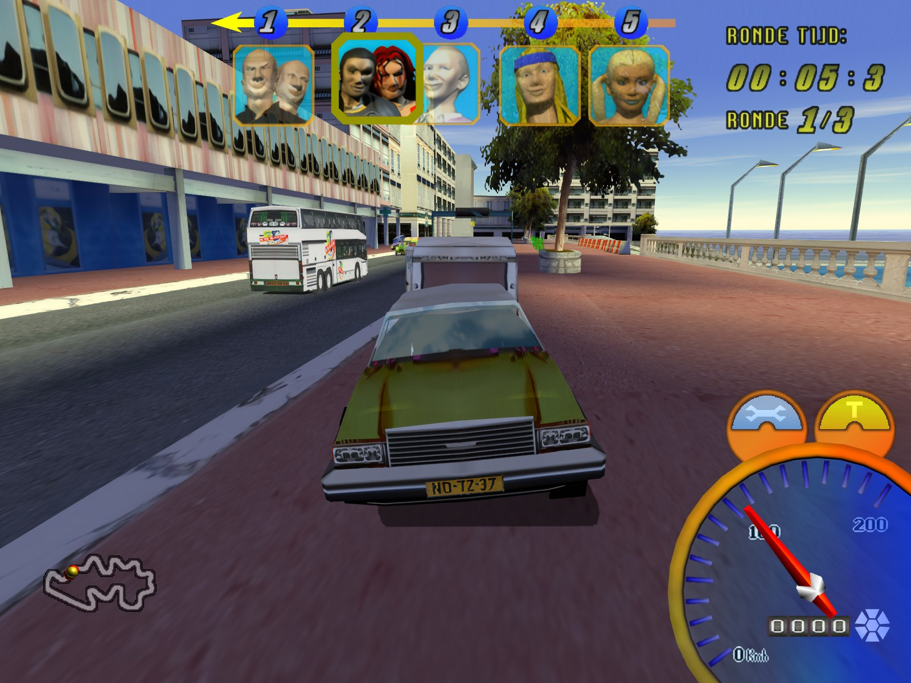
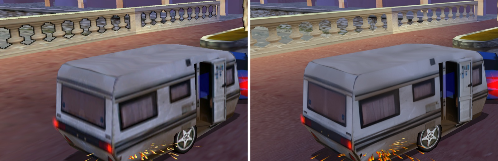
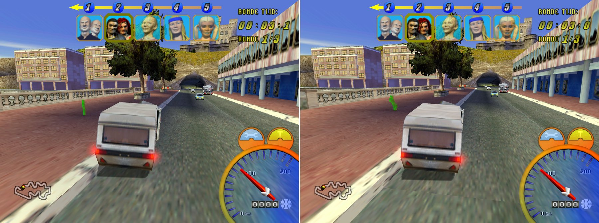
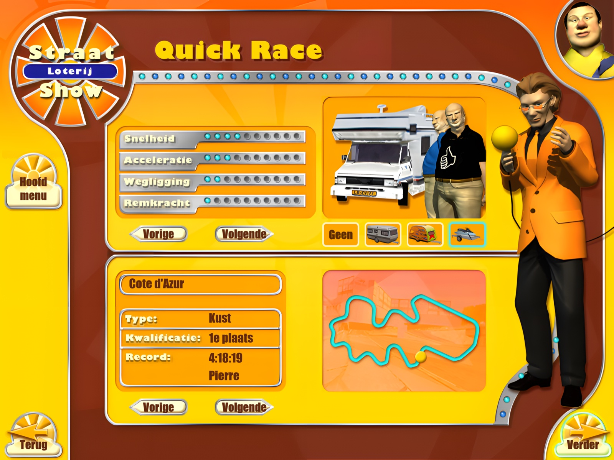
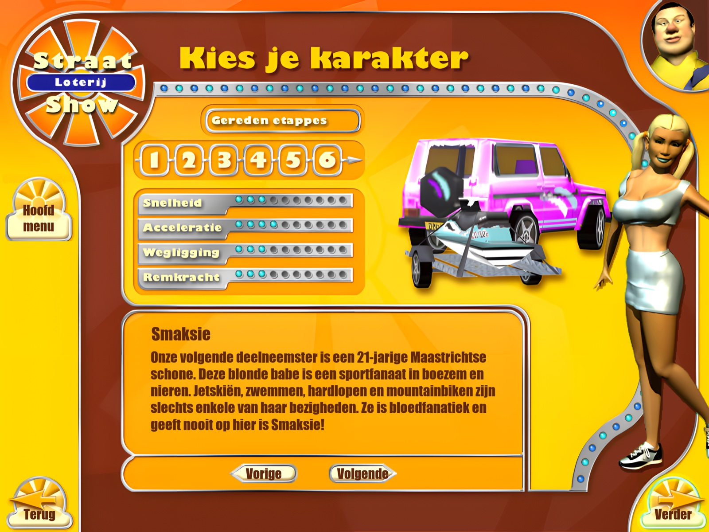

# 🏖️ Vakantie Racer Revived 🚘

**Davilex' Vakantie Racer (2000), herboren als echte Mac-app voor Apple Silicon. In HD, met een menu in 4K en een caravan achter elke auto.**

    

> [!IMPORTANT]
> **Je hebt de ISO van Vakantie Racer nodig.** De game zelf zit niet in deze repo, alleen de port. Download `VRACER.iso` via [Nationaal Archief Educatieve Games](https://nationaalarchiefeducatievegames.nl/archief/vakantie-racer/) ([direct op Archive.org](https://archive.org/details/vakantieracerholidayracer)) en geef hem aan `setup.sh`.



*English below.*

## ✨ Wat is er nieuw

| | |
|---|---|
| 🍎 **Native op de Mac** | Geen Wine, geen emulator. De spelcode uit de ISO wordt omgezet naar een echte Apple Silicon-app |
| 🎨 **HD-textures** | Elke texture 4x opgeschaald met AI (Real-ESRGAN). Druk **F9** om live te wisselen met het origineel |
| 🖥️ **Menu in 4K** | Scherp op elk Retina-scherm; de tekst in de plaatjes is opnieuw gezet in het echte lettertype |
| 🏕️ **Caravan kiezen** | Hang de tokkie-caravan, de hippie-caravan of de jetski achter elke auto (vinkje in Opties) |
| 🏎️ **Alle auto's vrij** | Ook de Ferrari, BMW Z3 en DeLorean |
| ⏸️ **Pauzemenu** | Esc pauzeert de race in plaats van hem af te breken |
| 🎮 **60 fps** | Strak, ook op 4K met anti-aliasing |

## 📸 Screenshots

**In de race, in HD:** Sjonnie en Anita met de tokkie-caravan op de Côte d'Azur.



**Achteruit kijken (toets 3):**



**Origineel vs. HD**, met F9 wissel je live:





**Quick Race met de caravankeuze:**



**Het menu in 4K:**



## 💿 Over deze repo

In deze repo zitten **geen spelbestanden**. `setup.sh` maakt alles uit de ISO (zie boven). Het HD-pack (588 MB) staat bij de [release hd-v1](https://github.com/DvT093/VakantieRacer-Revived/releases/tag/hd-v1); `setup.sh` downloadt het vanzelf.

## 🧰 Wat je nodig hebt
- Een Mac met Apple Silicon (M1 of nieuwer)
- `VRACER.iso` (zie boven)
- [Homebrew](https://brew.sh); setup.sh zegt precies wat je nog moet installeren

## 🚀 Installeren

```sh
git clone --recursive https://github.com/DvT093/VakantieRacer-Revived.git
cd VakantieRacer-Revived && ./setup.sh ~/Downloads/VRACER.iso
```

Of zeg in [Claude Code](https://claude.com/claude-code) in deze map: "hier is de ISO, zet het op".

setup.sh haalt de spelbestanden van je ISO, zet de spelcode om, bouwt de app en haalt het HD-pack op (ca. 590 MB). De eerste keer duurt het 15-30 minuten. Daarna dubbelklik je op **Vakantie Racer.app**. De ISO heb je dan niet meer nodig.

## 🔄 Updaten

Is er een nieuwe versie? Draai in dezelfde map:

```sh
git pull && ./setup.sh
```

Of zeg in Claude Code: "update het spel". setup.sh haalt ook de nieuwe SwARc en Davilex-RED op en bouwt alleen wat veranderd is, meestal in een paar minuten. De ISO en het HD-pack heb je niet opnieuw nodig. Alleen als een update de omgezette spelcode raakt, duurt het weer 15-30 minuten.

## Toetsen in de race

| Toets | Wat het doet |
|---|---|
| Pijltjes | Sturen, gas, remmen |
| Cmd | Turbo (Ctrl houdt macOS zelf voor Spaces) |
| Alt (Option) | Handrem |
| Spatie | Toeter |
| T | Je karakter zegt iets |
| Esc of P | Pauzemenu |
| F9 | Origineel of HD (in de race en in het menu) |
| F10 / F11 | Alleen anti-aliasing / alleen filtering |
| 1 / 2 / U / 4 | Bumpercamera / achtervolgcamera / vlak bij de auto / andere camera |
| 3 (vasthouden) | Achteruit kijken |
| 5 t/m 0 | Camera achter een andere auto |

## Opties en mods
- **Alles vrij** (Opties): de bonusauto's (Ferrari, BMW Z3, DeLorean) en alle etappes open.
- **Caravan kiezen** (Opties, standaard uit): kies op Quick Race en in de Garage welke aanhanger je trekt. Uit = elke auto rijdt met zijn eigen aanhanger, zoals in het origineel.
- **Opties > Gevorderd**: resolutie, anti-aliasing, filtering en het menu in 4K.
- Zelf modden: zie `mods/` en `CLAUDE.md`.

## ⚠️ Bekende problemen
- **BMW Z3 en DeLorean zien er kaal uit.** Het zijn verborgen auto's die de makers nooit goed van textures hebben voorzien: op de Vakantie Racer-CD staat voor geen van beide een eigen lak. De port geeft ze voorlopig een noodlak.

## Credits en licentie
- Gebouwd op [SwARc](https://github.com/JTM-rootstorm/x86recomp) van JT (MIT), een static recompiler voor x86-games.
- De code in deze repo is MIT (zie `LICENSE`).
- Vakantie Racer is van Davilex en blijft van de rechthebbende. Deze repo bevat geen spelbestanden; het HD-pack is gemaakt uit de originele textures en is alleen bedoeld voor wie de game zelf heeft. Dit project heeft niets met Davilex te maken.

---

# 🏖️ Vakantie Racer Revived 🚘 (English)

Davilex' Vakantie Racer (2000) reborn as a native Apple Silicon Mac app: AI-upscaled HD textures (F9 toggles the original live), a 4K menu, a caravan behind any car, all cars unlocked, a pause menu and a locked 60 fps. Screenshots above.

Vakantie Racer (Davilex, 2000, a Dutch holiday racing game) running natively on Apple Silicon Macs. No Wine, no emulator: the game code from the ISO is recompiled into a real Mac app, with HD textures, a 4K menu, 60 fps and a few mods (bonus cars, trailers, unlock all).

> [!IMPORTANT]
> **You need the Vakantie Racer ISO.** The game itself is not in this repo, only the port. Download `VRACER.iso` via [Nationaal Archief Educatieve Games](https://nationaalarchiefeducatievegames.nl/archief/vakantie-racer/) ([directly on Archive.org](https://archive.org/details/vakantieracerholidayracer)) and give it to `setup.sh`.

This repo contains **no game files**. `setup.sh` builds everything from the ISO (see above). The HD pack (588 MB) is attached to [release hd-v1](https://github.com/DvT093/VakantieRacer-Revived/releases/tag/hd-v1); `setup.sh` downloads it for you.

## 🧰 What you need
- A Mac with Apple Silicon (M1 or newer)
- `VRACER.iso` (see above)
- [Homebrew](https://brew.sh); setup.sh tells you exactly what to install

## 🚀 Install

```sh
git clone --recursive https://github.com/DvT093/VakantieRacer-Revived.git
cd VakantieRacer-Revived && ./setup.sh ~/Downloads/VRACER.iso
```

Or tell [Claude Code](https://claude.com/claude-code) in this folder: "here is the ISO, set it up".

The first run takes 15-30 minutes. Then double-click **Vakantie Racer.app**. You no longer need the ISO.

## 🔄 Update

Is there a new version? In the same folder, run:

```sh
git pull && ./setup.sh
```

Or tell Claude Code: "update the game". setup.sh also fetches the new SwARc and Davilex-RED and only rebuilds what changed, usually in a few minutes. You do not need the ISO or the HD pack again. Only an update that touches the recompiled game code takes 15-30 minutes again.

## Keys in the race
Arrows steer and drive, **Cmd** = turbo, **Alt** = handbrake, **Space** = horn, **T** = your character talks, **Esc/P** = pause, **F9** = original or HD, **F10/F11** = anti-aliasing / filtering only, **1/2/U/4** = cameras, hold **3** to look back, **5-0** = camera behind another car.

## Options
**Alles vrij** (unlock all) and **Caravan kiezen** (choose your trailer, off by default) in Options; resolution, anti-aliasing and the 4K menu under Options > Gevorderd.

## ⚠️ Known issues
- **The BMW Z3 and DeLorean look bare.** They are hidden cars the developers never properly textured: the Vakantie Racer CD has no paint for either. The port gives them a stand-in paint for now.

## Credits and license
Built on [SwARc](https://github.com/JTM-rootstorm/x86recomp) by JT (MIT). The code in this repo is MIT (see `LICENSE`). Vakantie Racer belongs to Davilex and its rights holder; this repo contains no game files, and the HD pack is derived from the original textures and meant only for people who own the game. This project is not affiliated with Davilex.
